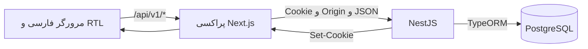

# برد وظایف فارسی

این پروژه یک برنامهٔ مدیریت وظایف با رابط فارسی و راست‌به‌چپ، ورود مبتنی بر کوکی، سه نقش کاربری و توضیحات غنی است. مرورگر از مسیرهای نسبی `/api/v1/*` در Next.js استفاده می‌کند؛ منطق کسب‌وکار و مجوزها در NestJS اجرا می‌شوند و داده‌ها در PostgreSQL نگهداری می‌شوند.

این راهنما از پیاده‌سازی فعلی درخت کاری تهیه شده است؛ برخی فایل‌های فعلی هنوز در Git ثبت نشده‌اند. منبع دستورها فایل‌های `package.json`، منبع نسخه‌های دقیق `package-lock.json` و منبع رفتارها فایل‌های کد پیوندشده در ادامه است. تأیید منبع به معنی اجرای همهٔ دستورها نیست؛ نتیجهٔ اجرای این نوبت در انتهای راهنما آمده است.

## فناوری‌ها و نسخه‌ها

| فناوری | نسخهٔ قفل‌شده یا تنظیم‌شده |
| --- | --- |
| Next.js، App Router | 15.5.27 |
| React | 19.3.0 |
| NestJS، بستهٔ core | 11.2.7 |
| TypeORM | 0.3.31 |
| PostgreSQL در Compose | `postgres:16-alpine`؛ برچسب تصویر، نه نسخهٔ patch ثابت |
| TipTap React | 3.31.4 |
| TypeScript | 5.9.3 |
| Tailwind CSS | 3.4.19 |
| Headless UI React | 2.2.10 |
| Playwright | 1.64.0 |
| pg | 8.23.1 |
| bcryptjs | 3.0.3 |

وابستگی Headless UI در [بستهٔ frontend](frontend/package.json) تعریف شده و برای کنترل‌های رابط استفاده می‌شود. نسخه‌های بازه‌ای در manifest با نسخهٔ دقیق lockfile یکسان تلقی نمی‌شوند. حداقل Node.js موردنیاز NestJS نصب‌شده طبق lockfile برابر ۲۰ است؛ این نوبت با Node.js 22.19.0 و npm 10.9.3 بررسی شد. مخزن نسخهٔ npm را با `packageManager` تثبیت نکرده است. Docker و Docker Compose برای پایگاه داده لازم‌اند؛ runner مرورگری به Microsoft Edge نصب‌شده نیاز دارد.

## ساختار مخزن

```text
AGENTS.md
package.json
package-lock.json
docker-compose.yml
README.md
backend/
  .env.example
  package.json
  src/
    app.module.ts
    main.ts
    configure-app.ts
    auth/
    users/
    tasks/
    database/
      data-source.ts
      entities/
      migrations/1791701867468-InitialTaskBoard.ts
      migrate-cli.ts
      seed-cli.ts
      seed.ts
frontend/
  .env.example
  package.json
  next.config.ts
  playwright.config.ts
  app/
    (protected)/
    api/v1/[...path]/route.ts
    login/
  components/
  lib/
  tests/
docs/
tests/configuration.test.cjs
scripts/verify-isolated.cjs
```

ساختار بالا مسیرهای موجود را نشان می‌دهد، نه فهرست کامل فایل‌ها. `scripts/verify-isolated.cjs` و چند فایل اصلاحی/فونت در وضعیت فعلی هنوز untracked هستند؛ وجود در پوشه با حضور در commit یکسان نیست. `.env`های واقعی، وابستگی‌ها، خروجی build و آثار آزمون در [.gitignore](.gitignore) مستثنا شده‌اند.

## معماری و جریان درخواست



[کلاینت API](frontend/lib/api.ts) درخواست‌ها را به همان مبدأ مرورگر می‌فرستد. [پراکسی](frontend/app/api/v1/[...path]/route.ts) هدرهای منتخب، query، وضعیت پاسخ و کوکی‌های جداگانه را منتقل می‌کند؛ سقف بدنهٔ درخواست ۱۰۰ KiB و مهلت fetch بالادست ۱۵ ثانیه است. خطای اتصال پاسخ 503 دارد. `BACKEND_URL` فقط در سمت سرور مصرف می‌شود. [تنظیم Next.js](frontend/next.config.ts) rewrite موازی ندارد.

[NestJS](backend/src/configure-app.ts) پیشوند `api/v1`، اعتبارسنجی ورودی، پاسخ خطای مشترک و جلوگیری از cache را اعمال می‌کند. Guardها احراز هویت و نقش را بررسی می‌کنند و سرویس‌ها مجوزهای حساس را داخل transaction دوباره می‌سنجند. مخفی‌کردن دکمه‌ها مرز امنیتی نیست.

## نصب و راه‌اندازی در Windows PowerShell

تمام دستورهای زیر، مگر جایی که خلاف آن نوشته شده، از ریشهٔ پروژه اجرا می‌شوند. دستورهای PowerShell برای فایل‌ها عملیات راه‌اندازی‌اند؛ نام script ساختگی به پروژه اضافه نشده است.

### ۱. نصب وابستگی‌ها

```powershell
Set-Location H:\projects\viraco
npm ci
```

ریشه دو workspace با نام‌های `frontend` و `backend` دارد و lockfile نسخهٔ ۳ است. نصب را از ریشه انجام دهید. این دستور در این نوبت اجرا نشده تا وابستگی‌های محیط موجود تغییر نکنند.

### ۲. آماده‌سازی محیط

برای جلوگیری از بازنویسی فایل‌های محلی موجود:

```powershell
if (!(Test-Path backend/.env)) { Copy-Item backend/.env.example backend/.env }
if (!(Test-Path frontend/.env.local)) { Copy-Item frontend/.env.example frontend/.env.local }
if (!(Test-Path .env)) { New-Item -ItemType File -Path .env | Out-Null }
```

قالب ریشهٔ `.env.example` وجود ندارد. در `.env` ریشه، متغیر `POSTGRES_PASSWORD` را با رمز انتخابی محلی قرار دهید. همان مقدار باید در `DATABASE_PASSWORD` فایل `backend/.env` باشد؛ هیچ مقدار واقعی در این راهنما درج نمی‌شود. فایل frontend فقط `BACKEND_URL=http://127.0.0.1:3001` را لازم دارد. از اشتراک‌گذاری یا نمایش فایل‌های واقعی محیط در دمو خودداری کنید.

در `backend/.env`، همهٔ مقادیر `REPLACE_WITH_...` را با تنظیمات واقعی خود جایگزین کنید. خصوصاً سه رمز seed و `JWT_ACCESS_SECRET` را تنظیم کنید. طبق توضیح [قالب backend](backend/.env.example)، تولید secret از `crypto.randomBytes(48).toString("base64url")` انجام می‌شود؛ مقدار تولیدشده باید خصوصی بماند. secret حداقل ۳۲ بایت دارد و کد مقادیر دارای عبارت‌های replace/change me/example را رد می‌کند.

### متغیرهای محیطی واقعی

| محل مصرف | نام‌ها و تنظیمات |
| --- | --- |
| Compose، فایل `.env` ریشه | `POSTGRES_PASSWORD`؛ اجباری و بدون پیش‌فرض |
| backend، اتصال دیتابیس | `DATABASE_HOST=localhost`، `DATABASE_PORT=5433`، `DATABASE_NAME=taskboard`، `DATABASE_USER=taskboard`، `DATABASE_PASSWORD` |
| backend، HTTP | `PORT=3001` در قالب؛ در نبود آن نیز 3001 |
| backend، JWT | `JWT_ACCESS_SECRET`، `JWT_ISSUER=taskboard-backend`، `JWT_AUDIENCE=taskboard-browser`، `JWT_ACCESS_TTL_SECONDS=300` |
| backend، نشست | `REFRESH_TTL_SECONDS=604800` |
| backend، مبدأ و کوکی | `APP_ORIGIN=http://localhost:3000`، `COOKIE_SECURE=false`، `COOKIE_SAME_SITE=lax`، `ACCESS_COOKIE_NAME=tb_access`، `REFRESH_COOKIE_NAME=tb_refresh` |
| seed | `SEED_OWNER_EMAIL`، `SEED_OWNER_PASSWORD`، `SEED_MANAGER_EMAIL`، `SEED_MANAGER_PASSWORD`، `SEED_MEMBER_EMAIL`، `SEED_MEMBER_PASSWORD` |
| پراکسی frontend | `BACKEND_URL=http://127.0.0.1:3001` |
| حالت اجرا | `NODE_ENV`؛ seed در production ممنوع و احراز هویت production نیازمند HTTPS و کوکی Secure است |
| آزمون دیتابیس | `TEST_DATABASE`؛ برای آزمون‌های تغییردهنده باید `true` باشد |
| آزمون HTTP backend | `TEST_BASE_URL`؛ اختیاری برای هدف‌گیری سرویس موجود؛ runner آن را حذف می‌کند |
| Playwright | `PLAYWRIGHT_BASE_URL`، `PLAYWRIGHT_CHANNEL`؛ پیش‌فرض URL برابر `http://localhost:3000` است |
| آزمون منطقهٔ زمانی | `TZ` فقط در آزمون frontend موقتاً تغییر می‌کند؛ تنظیم لازم راه‌اندازی نیست |

Compose همچنین `POSTGRES_DB=taskboard` و `POSTGRES_USER=taskboard` را داخل کانتینر تنظیم می‌کند؛ این دو در Compose ثابت‌اند. runner موقت همین نام‌های `POSTGRES_PASSWORD`، `POSTGRES_DB` و `POSTGRES_USER` را برای کانتینر آزمون می‌سازد.

[AuthConfig](backend/src/auth/auth.config.ts) زمان access را بین ۳۰ تا ۹۰۰ ثانیه و refresh را بین ۳۶۰۰ تا ۲۵۹۲۰۰۰ ثانیه می‌پذیرد. `COOKIE_SAME_SITE` فقط `lax` یا `strict` است؛ نام دو کوکی باید متفاوت باشد. `APP_ORIGIN` باید مبدأ دقیق HTTP(S) بدون مسیر باشد. در production، `COOKIE_SECURE=true` و مبدأ HTTPS الزامی است.

[DataSource](backend/src/database/data-source.ts) فایل `backend/.env` را صریحاً بارگذاری می‌کند. [ماژول برنامه](backend/src/app.module.ts) مسیرهای محیط کنار backend و مبتنی بر working directory را بررسی می‌کند؛ بنابراین اجرای دستورهای مستند از ریشه و استفاده از فایل backend اهمیت دارد. متغیرهای از قبل تنظیم‌شدهٔ process را نیز پیش از اجرا بررسی کنید؛ runner برای جداسازی آزمون از همین سازوکار استفاده می‌کند.

### ۳. PostgreSQL با Docker Compose

```powershell
npm run db:up
docker compose config --quiet
```

script اول دقیقاً `docker compose up -d postgres` است. Compose فقط دیتابیس را اجرا می‌کند: کانتینر `task-board-postgres`، دیتابیس و کاربر `taskboard`، نگاشت `127.0.0.1:5433:5432` و volume پایدار با کلید `task-board-postgres` در فایل Compose. این کلید را نباید نام قطعی volume ساخته‌شده در Docker تلقی کرد؛ فایل Compose برای آن `name` صریح تعیین نکرده است. healthcheck با `pg_isready -U taskboard -d taskboard` اجرا می‌شود. اعتبارسنجی quiet هیچ secret را چاپ نمی‌کند.

تغییر رمز در فایل محیط، رمز نقش PostgreSQL داخل volume از قبل مقداردهی‌شده را عوض نمی‌کند. برای volume موجود باید رمز واقعی همان نقش را بدانید؛ این مخزن script چرخش رمز ارائه نمی‌کند. برای رفع خطای اتصال، volume یا داده‌ها را حذف نکنید.

### ۴. migration

```powershell
npm run migration:show
npm run migration:run
```

اولی وضعیت migration را با TypeORM نشان می‌دهد؛ دومی [CLI واقعی](backend/src/database/migrate-cli.ts) را اجرا می‌کند و migrationها را با `transaction: 'all'` اعمال می‌کند. اجرای سرور migration را خودکار اجرا نمی‌کند. `synchronize` در هر دو پیکربندی TypeORM برابر `false` است.

تنها migration موجود [InitialTaskBoard](backend/src/database/migrations/1791701867468-InitialTaskBoard.ts) جداول `users`، `tasks` و `refresh_sessions`، enumها، indexها و constraintها را می‌سازد؛ ایجاد افزونهٔ `uuid-ossp` نیز به مجوز لازم دیتابیس نیاز دارد. CLI migration و seed طبق [محافظ محلی](backend/src/database/local-guard.ts) فقط دیتابیس محلی `taskboard` روی 5433 یا مقصد آزمون علامت‌گذاری‌شده را قبول می‌کنند. `migration:show` از CLI مستقیم TypeORM استفاده می‌کند و این محافظ را فراخوانی نمی‌کند؛ اتصال محیط آن را نیز بررسی کنید.

script تولید migration در manifest وجود دارد، اما نام/مسیر migration تازه‌ای برای این راهنما ساخته نشده است. تغییر schema باید با migration بازبینی‌شده انجام شود. دستور rollback یا پاک‌سازی دیتابیس در این راهنما تجویز نمی‌شود.

### ۵. seed و حساب‌های ورود

پس از تنظیم رمزها در `backend/.env` و اجرای migration:

```powershell
npm run seed
```

| نقش | ایمیل موجود در فایل نمونه | متغیر رمز |
| --- | --- | --- |
| OWNER | `owner@taskboard.local` | `SEED_OWNER_PASSWORD` |
| MANAGER | `manager@taskboard.local` | `SEED_MANAGER_PASSWORD` |
| MEMBER | `member@taskboard.local` | `SEED_MEMBER_PASSWORD` |

این ایمیل‌ها پیش‌فرض داخل تابع seed نیستند؛ مقادیر فایل نمونه‌اند. [seed](backend/src/database/seed.ts) هر سه ایمیل و رمز را از محیط می‌خواند، ایمیل‌ها را trim و lowercase می‌کند و متفاوت‌بودن آن‌ها را کنترل می‌کند. رمز هر حساب حداقل ۱۲ نویسه و حداکثر ۷۲ بایت UTF-8 است. UUID کاربران هنگام درج در دیتابیس تولید می‌شود؛ شناسهٔ UUID ثابت نمونه وجود ندارد.

seed فقط کاربرِ غایب را با نقش مربوط و وضعیت فعال ایجاد می‌کند؛ رمز با bcrypt و cost برابر ۱۲ هش می‌شود. اجرای مجدد، رمز، نقش یا فعال‌بودن رکورد موجود را عوض نمی‌کند. تغییر متغیر رمز پس از ایجاد حساب، رمز ورود آن حساب را تغییر نمی‌دهد. بازیابی/تغییر رمز در API فعلی پیاده نشده است؛ برای حساب موجود باید رمز قبلی معتبر را داشته باشید. seed هیچ وظیفهٔ نمونه‌ای ایجاد نمی‌کند و در `NODE_ENV=production` رد می‌شود.

در `/login` ایمیل تنظیم‌شده و همان رمزی را وارد کنید که هنگام ایجاد اولیهٔ حساب تعیین کرده‌اید. پس از ورود OWNER، صفحهٔ `/users` امکان ساخت کاربر با email/password/role و تغییر role/isActive را دارد. endpoint عمومی ثبت‌نام وجود ندارد.

### ۶. اجرای برنامه‌ها

از ریشه در دو ترمینال PowerShell:

```powershell
npm run start:dev --workspace backend
```

```powershell
npm run dev --workspace frontend
```

یا برای اجرای هم‌زمان هر دو در یک ترمینال:

```powershell
npm run dev
```

| سرویس/صفحه | نشانی در تنظیمات محلی مستند |
| --- | --- |
| ورود | `http://localhost:3000/login` |
| برد | `http://localhost:3000/` |
| کاربران، فقط OWNER | `http://localhost:3000/users` |
| جزئیات وظیفه | مسیر `/tasks/[id]` با UUID واقعی وظیفه |
| health از پراکسی | `http://localhost:3000/api/v1/health` |
| health مستقیم backend | `http://127.0.0.1:3001/api/v1/health` |
| دیتابیس از میزبان | `127.0.0.1:5433` |

backend صریحاً روی `127.0.0.1` گوش می‌دهد؛ پورت آن از `PORT` می‌آید. 3000 پورت پیش‌فرض Next است؛ اگر Next پورت دیگری انتخاب کرد، مبدأ مرورگر و `APP_ORIGIN` باید هماهنگ شوند. تغییر hostname بین localhost و 127.0.0.1 نیز برای Origin و کوکی مهم است.

برای اجرای خروجی ساخته‌شده، پس از تنظیم محیط و build، در دو ترمینال:

```powershell
npm run build
npm run start --workspace backend
```

```powershell
npm run start --workspace frontend
```

script `start` backend برابر `nest start` و script frontend برابر `next start` است؛ script مستقل `start:prod` وجود ندارد. این دستورها به معنی آماده‌بودن استقرار واقعی production نیستند.

### توقف و اجرای دوباره

فرایندهای foreground را با `Ctrl+C` متوقف و با همان دستورهای start/dev دوباره اجرا کنید. پس از تغییر محیط نیز فرایند مربوط را دوباره اجرا کنید.

```powershell
npm run db:down
npm run db:up
```

`db:down` دقیقاً `docker compose down` است؛ گزینهٔ حذف volume ندارد. دستور بعدی سرویس دیتابیس را دوباره ایجاد/اجرا می‌کند. پس از آماده‌شدن دیتابیس، برنامه‌ها را با دستورهای بالا اجرا کنید. script اختصاصی restart برنامه‌ها وجود ندارد.

## نقش‌ها و مجوزها

منابع: [RolesGuard](backend/src/auth/roles.guard.ts)، [سیاست وظایف](backend/src/auth/task-policy.service.ts)، [سرویس کاربران](backend/src/users/users.service.ts).

| عملیات | OWNER | MANAGER | MEMBER |
| --- | --- | --- | --- |
| ساخت وظیفه | مجاز | مجاز | مجاز |
| مشاهده/ویرایش وظیفه | همه | همه | فقط ساختهٔ خود یا واگذارشده به خود |
| حذف وظیفه | همه | همه | فقط ساختهٔ خود |
| واگذاری جدید | هر کاربر فعال | هر کاربر فعال | خود یا بدون مسئول |
| فهرست کاربران قابل واگذاری | مجاز؛ فقط id/email فعال‌ها | مجاز؛ فقط id/email فعال‌ها | غیرمجاز |
| مدیریت کاربران و نقش/وضعیت | مجاز | غیرمجاز | غیرمجاز |

MEMBER می‌تواند واگذاری موجود را بدون تغییر حفظ کند، اما نمی‌تواند کاربر دیگری را تازه مسئول کند. سازنده از کاربر احرازشده تعیین می‌شود و قابل تغییر نیست. غیرفعال‌کردن کاربر نشست‌های او را لغو می‌کند؛ فعال‌سازی مجدد آن نشست‌ها را برنمی‌گرداند. آخرین OWNER فعال را نمی‌توان غیرفعال یا تنزل نقش داد. قفل advisory تراکنشی PostgreSQL بررسی‌های نقش/آخرین مالک را با تغییرات هم‌زمان هماهنگ می‌کند؛ update/delete وظیفه نیز قفل ردیف دارند.

## مدیریت وظایف و API

تمام مسیرهای جدول زیر زیرمجموعهٔ `/api/v1` هستند و نیاز به کاربر فعال دارند.

| روش | مسیر | رفتار |
| --- | --- | --- |
| GET | `/todos` | فهرست صفحه‌بندی‌شده |
| POST | `/todos` | ساخت وظیفه |
| GET | `/todos/:id` | دریافت وظیفه |
| PATCH | `/todos/:id` | ویرایش جزئی |
| DELETE | `/todos/:id` | حذف، پاسخ 204 |

فیلدها: `title`، `status`، `priority`، `assigneeId`، `dueDate` و `description`. عنوان پس از trim باید ۱ تا ۲۵۵ نویسه باشد. وضعیت‌ها دقیقاً `todo`، `in_progress` و `done` و اولویت‌ها `low`، `medium` و `high` هستند. پیش‌فرض ساخت `todo` و `medium` است. مسئول و موعد nullable هستند؛ توضیحات پیش‌فرض سند خالی است. PATCH خالی یا فیلد ناشناخته رد می‌شود.

[DTOها](backend/src/tasks/tasks.dto.ts) queryهای `status`، `assigneeId`، `page` و `pageSize` را می‌پذیرند؛ page پیش‌فرض ۱، pageSize پیش‌فرض ۲۰ و حداکثر ۱۰۰ است. [سرویس](backend/src/tasks/tasks.service.ts) محدودیت مشاهدهٔ MEMBER را پیش از count و pagination در SQL اعمال می‌کند؛ ترتیب createdAt و سپس id نزولی است. رابط برد هر صفحه ۱۲ وظیفه درخواست می‌کند.

موعد یک timestamp دارای timezone است، در `timestamptz` ذخیره و در JSON به UTC برگردانده می‌شود. [منطق موعد frontend](frontend/lib/due-date.ts) مقدار تغییرنکرده را از PATCH حذف می‌کند تا ثانیه/میلی‌ثانیه از دست نرود؛ پاک‌کردن موعد `null` می‌فرستد. ورودی بومی تاریخ/زمان و نمایش فارسی با تقویم ورودی شمسی یکسان نیستند.

## TipTap و JSONB

[ویرایشگر](frontend/components/editor.tsx) JSON حاصل از `editor.getJSON()` را می‌فرستد. [entity وظیفه](backend/src/database/entities/task.entity.ts) توضیحات را بدون تبدیل به HTML در ستون `jsonb` نگه می‌دارد.

[اعتبارسنج سرور](backend/src/tasks/tiptap.validator.ts) فقط گره‌های `doc`، `paragraph`، `text`، `heading`، `blockquote`، `bulletList`، `orderedList` و `listItem` و markهای `bold`، `italic` و `link` را می‌پذیرد. سقف JSON سریال‌شده ۶۵۵۳۶ بایت، عمق ۲۰ و تعداد گره ۲۰۰۰ است. پیوند باید HTTP(S)، بدون credentials، whitespace یا نویسهٔ کنترلی باشد. سند خالی معتبر است؛ embed و انواع خارج از قرارداد پذیرفته نمی‌شوند.

[بررسی payload](backend/src/tasks/task-payload.pipe.ts) پیش از class-transformer و سپس validator اجرا می‌شود. frontend نیز [همان قرارداد](frontend/lib/document.ts) را بررسی و محتوای ذخیره‌شده را به گره‌های React تبدیل می‌کند؛ نمایش با تزریق HTML خام انجام نمی‌شود. تنظیم StarterKit و [TaskLink](frontend/lib/task-link.ts) قابلیت‌های تازهٔ ناسازگار با قرارداد ذخیره‌سازی را محدود کرده‌اند.

## احراز هویت و امنیت

[کنترلر ورود](backend/src/auth/auth.controller.ts) مسیرهای `POST /auth/login`، `POST /auth/refresh`، `POST /auth/logout` و `GET /auth/me` را ارائه می‌کند. access token از نوع JWT با HS256 و کنترل issuer/audience/expiry است. refresh token تصادفی است و فقط digest از نوع SHA-256 آن ذخیره می‌شود؛ پاسخ JSON توکن‌ها را برنمی‌گرداند.

[کوکی‌ها](backend/src/auth/auth.cookies.ts) HttpOnly و دارای SameSite تنظیم‌شده‌اند؛ مسیر access برابر `/api/v1` و مسیر refresh برابر `/api/v1/auth` است. [سرویس احراز هویت](backend/src/auth/auth.service.ts) نقش، وضعیت کاربر و نشست را از دیتابیس بررسی می‌کند. refresh قبلی را داخل transaction لغو می‌کند و نشست تازه را با همان انقضای مطلق اولیه می‌سازد. خروج، refresh و غیرفعال‌سازی، access وابسته به نشست لغوشده را نیز بی‌اعتبار می‌کنند.

[CSRF guard](backend/src/auth/csrf.guard.ts) برای روش‌های تغییردهنده Origin دقیق و عدم `sec-fetch-site: cross-site` را لازم می‌داند؛ این الزام شامل ورود نیز هست. frontend توکن را در localStorage/sessionStorage ذخیره نمی‌کند و درخواست refresh هم‌زمان را در همان context به اشتراک می‌گذارد.

[محدودکنندهٔ ورود](backend/src/auth/login-rate.guard.ts) پنجرهٔ ۶۰ ثانیه‌ای در حافظهٔ همان process دارد: ۱۵ تلاش ناموفق حساب و ۳۰۰ تلاش peer؛ پاسخ محدودیت 429 با Retry-After است. [اعتبارسنجی خام](backend/src/raw-payload.pipe.ts) و whitelist ورودی فیلدهای نامعتبر را رد می‌کنند. [فیلتر خطا](backend/src/api-exception.filter.ts) و پراکسی ساختار `statusCode`، `error`، `message` و `details` را دارند و خطای داخلی را با پیام عمومی برمی‌گردانند.

## آزمون و کنترل کیفیت

### بررسی‌های بدون تغییر دیتابیس

```powershell
npm test --workspace frontend
npm run test:configuration
npm run typecheck --workspace backend
npm run typecheck --workspace frontend
npm run lint
npm run build
npm run test:e2e --workspace frontend -- --list
```

فهرست Playwright فقط کشف سناریوهاست و اجرای مرورگر محسوب نمی‌شود. آزمون frontend شامل قرارداد JSON، پراکسی، مجوز حذف، refresh و حفظ موعد است؛ آزمون پیکربندی الزام رمز و loopback بودن Compose را کنترل می‌کند.

### آزمون backend و Edge با دیتابیس مستقل

دستورهای واقعی suiteها:

```powershell
npm test --workspace backend
npm run test:contracts --workspace backend
npm run test:database --workspace backend
npm run test:auth --workspace backend
npm run test:rbac --workspace backend
npm run test:tasks --workspace backend
```

این‌ها جایگزین راه‌اندازی محیط آزمون نیستند. suite کامل backend به‌ترتیب contracts/database/auth/rbac/tasks را اجرا می‌کند. آزمون‌های دیتابیس عملیات تغییردهنده و rollback دارند؛ مقصد توسعه را برای آن‌ها استفاده نکنید. محافظ آزمون، `TEST_DATABASE=true`، میزبان loopback، نام مطابق `taskboard_test_[a-z0-9_]+` و پورتی غیر از 5433 را لازم می‌داند. Playwright نیز این شرایط و برابری `PLAYWRIGHT_BASE_URL` با `APP_ORIGIN` را بررسی می‌کند؛ خودش webServer یا seed خودکار ندارد.

مسیر موجود برای آماده‌سازی و اجرای کامل:

```powershell
npm run verify:isolated
```

[runner](scripts/verify-isolated.cjs) کانتینر تصادفی با storage موقت tmpfs روی `127.0.0.1:15434` می‌سازد؛ رمزها و حساب‌های مستقل `owner@test.local`، `manager@test.local` و `member@test.local` تولید می‌کند، migration و seed دوباره، آزمون‌ها، lint، build و typecheck را اجرا می‌کند. سپس backend روی 3401 و frontend روی 3400 را اجرا و Edge را آزمایش می‌کند. در پایان فرایندهای خودش و همان کانتینر موقت را پاک می‌کند. پورت‌های 15434، 3400 و 3401 باید آزاد باشند. دیتابیس توسعه هدف آن نیست، اما خود runner عمداً دیتابیس آزمون را ایجاد و حذف می‌کند؛ در این نوبت اجرا نشده است.

برای اجرای فقط مرحلهٔ مرورگری runner پس از وجود خروجی build:

```powershell
npm run verify:isolated -- --e2e-only
```

دستور مستقیم Edge، صرفاً داخل محیط آزمون مستقل از قبل آماده با حساب‌ها و هر دو سرویس فعال:

```powershell
$env:PLAYWRIGHT_CHANNEL = 'msedge'
npm run test:e2e --workspace frontend
```

این دو خط به‌تنهایی محیط لازم را آماده نمی‌کنند. runner کانال `msedge` و متغیرهای لازم را خودش تنظیم می‌کند. سناریوها شامل سه نقش، مدیریت کاربران، فیلتر/صفحه‌بندی، خطای سرویس، وظیفهٔ واگذارشده، RTL، keyboard focus و axe هستند. آزمون خودکار جای بازبینی کامل screen reader را نمی‌گیرد.

## تصمیم‌های معماری

- دو workspace نصب و scriptهای مشترک را در ریشه نگه می‌دارند؛ UI و منطق سرور تفکیک شده‌اند.
- پراکسی هم‌مبدأ کوکی و Origin را منتقل می‌کند؛ مجوزها در NestJS و دیتابیس کنترل می‌شوند.
- نقش در JWT منبع مجوز نیست؛ بررسی وضعیت نشست/کاربر امکان ابطال فوری را فراهم می‌کند.
- JSONB برای نگهداری ساختار TipTap استفاده شده و اعتبارسنجی درخت و نمایش React قرارداد آن را محدود می‌کنند.
- migration صریح، constraintهای دیتابیس و قفل تراکنشی برای سازگاری schema و تغییرات هم‌زمان استفاده شده‌اند.

این تصمیم‌ها از کد فعلی و [سند معماری](docs/architecture.md) استخراج شده‌اند؛ سابقهٔ تصمیم‌گیری یا تأیید انسانی مستقل از آن‌ها قابل اثبات نیست.

## فرایند توسعه با کمک Codex

[سند فرایند AI](docs/ai-workflow.md) و [گزارش اصلاح نهایی](docs/FINAL-REMEDIATION-REPORT.md) استفاده از Codex را برای بازرسی منبع، کمک به پیاده‌سازی، مستندسازی و اجرای بررسی‌ها ثبت کرده‌اند. گزارش اصلاح، کمک اجرایی در validation خام، قالب خطا، حفظ موعد، سازگاری TipTap، به‌روزرسانی وابستگی و جداسازی آزمون‌ها را صریحاً به Codex نسبت می‌دهد؛ این کارها انسانیِ صرف معرفی نمی‌شوند.

موارد استفادهٔ ثبت‌شده شامل شناسایی آسیب‌پذیری‌ها و audit امنیتی، بررسی سازگاری پراکسی/NestJS و قوانین AGENTS.md، بهبود نگهداشت‌پذیری از طریق قرارداد خطای مشترک و جلوگیری از تکرار خطا، رفع اشکال و آزمون رگرسیون، و تطبیق تکلیف استخدامی در ماتریس ۱۳۳ موردی است. هیچ benchmark برای ادعای افزایش کارایی عددی وجود ندارد و چنین ادعایی نمی‌شود.

در این نوبت، Codex منبع و تنظیمات را برای بازنویسی README بررسی و کنترل‌های بدون تغییر دیتابیس را اجرا کرد. گزارش‌های قبلی شواهد مستندِ فرایند هستند، نه اثبات مستقل ترتیب همهٔ مراحل یا تأیید انسانی. مسئولیت بازبینی تغییرات، پذیرش ریسک و ارسال نهایی با مالک پروژه است؛ تأیید یا همکاری انسانی ناموجود ساخته نشده است.

فایل دستورهای پروژه [AGENTS.md](AGENTS.md) مرجع قواعد این کار است. گزارش اصلاح نهایی تصریح می‌کند که در آن مرحله از agent فرعی، skill سفارشی یا hook استفاده نشده است؛ در بازنویسی این README نیز agent فرعی یا skill فراخوانی نشد. محتوای درخواست‌ها فقط تا حدی که در گزارش‌های موجود ثبت شده قابل استناد است؛ آرشیو کامل promptهای مراحل در این راهنما ادعا نمی‌شود.

## محدودیت‌ها و موارد تأییدنشده

- [گزارش قبلی وابستگی‌ها](docs/known-limitations.md) در تاریخ ۲۰۲۶-۱۰-۱۲، ۶ یافتهٔ high کامل و ۵ یافتهٔ high در گراف production-classified برای زنجیرهٔ braces ثبت کرده است. این نوبت audit آنلاین اجرا نشده؛ وضعیت جاری registry یا رفع‌نشدن فعلی آسیب‌پذیری مستقل تأیید نشده است.
- rate limit بین چند instance مشترک نیست؛ هماهنگی refresh بین tabها، ابطال کل خانواده در replay و پاک‌سازی زمان‌بندی‌شدهٔ نشست‌ها پیاده نشده‌اند.
- ثبت‌نام عمومی، تغییر/بازیابی رمز، حذف کاربر، attachment، جست‌وجوی تمام‌متن و به‌روزرسانی بلادرنگ در API/UI بررسی‌شده وجود ندارند. فهرست users/assignees صفحه‌بندی ندارد.
- Compose فقط PostgreSQL را اجرا می‌کند؛ TLS، backup/restore و راه‌اندازی نخستین OWNER تولید، workflow کامل آماده‌ای ندارند. seed توسعه برای production مجاز نیست.
- گزارش اجرای قبلی آزمون‌های دیتابیس/Edge به workaround موقت socket در Windows اشاره می‌کند؛ آن workaround بخشی از مخزن نیست. موفقیت مستقیم runner روی این میزبان در این نوبت ادعا نمی‌شود.
- PDF مستقل تکلیف در مخزن بررسی‌شده در دسترس نیست؛ پوشش مستندات با ماتریس موجود سنجیده شده، نه متن اصلی ناموجود. ویدیوی فارسی حداکثر پنج‌دقیقه‌ای، ارسال ایمیل/رسید و مهلت ۶۰ ساعت، تأیید مستقل انسانی، بررسی کامل دستی RTL/screen reader و استقرار HTTPS تأیید نشده‌اند.

## مستندات پشتیبان

| سند | کاربرد |
| --- | --- |
| [قوانین پروژه](AGENTS.md) | قواعد معماری، امنیت، migration و بررسی تغییرات AI |
| [معماری](docs/architecture.md) | جریان درخواست، نشست و ذخیره‌سازی |
| [API](docs/api.md) | قرارداد endpointها، validation و خطا |
| [فرایند AI](docs/ai-workflow.md) | دامنهٔ کمک هوش مصنوعی و حدود شواهد |
| [محدودیت‌ها](docs/known-limitations.md) | ریسک‌ها و بدهی‌های ثبت‌شده |
| [آمادگی تحویل](docs/delivery-readiness.md) | وضعیت گزارش‌شدهٔ تحویل |
| [ممیزی تکلیف](docs/FINAL-HIRING-ASSIGNMENT-AUDIT.md) | ماتریس ۱۳۳ الزام و شکاف‌ها |
| [گزارش اصلاح](docs/FINAL-REMEDIATION-REPORT.md) | یافته‌ها، اصلاح‌ها و نتایج اجرای قبلی |
| [سناریوی دمو](docs/demo-script-fa.md) | برنامهٔ ضبط، نه مدرک وجود ویدیو |
| [فاز دیتابیس](docs/phase-2-database.md)، [احراز هویت](docs/phase-3-authentication.md)، [RBAC](docs/phase-4-rbac.md)، [وظایف](docs/phase-5-tasks.md) | یادداشت‌های تاریخی؛ در تعارض، کد فعلی مبناست |
| [مجوز فونت](frontend/app/fonts/OFL.txt) | مجوز فونت محلی رابط |

## نتیجهٔ بررسی این بازنویسی

در تاریخ ۲۰۲۶-۱۰-۱۲، `npm run lint`، `npm run build`، typecheck هر دو workspace، ۷ آزمون frontend، ۲ آزمون پیکربندی و `docker compose config --quiet` موفق بودند. دستور فهرست Playwright شش سناریو را شناسایی کرد. build هشدار شناسایی‌نشدن افزونهٔ Next در ESLint داشت؛ lint مستقل موفق بود.

نصب مجدد، کپی/ساخت فایل محیط، شروع/توقف سرویس‌ها، migration، seed، آزمون‌های backend و اجرای واقعی Edge/runner در این نوبت اجرا نشدند تا محیط و دیتابیس موجود تغییر نکنند. دستورها از manifest/پیکربندی بررسی شده‌اند؛ نتایج قبلی در گزارش اصلاح از اجرای این نوبت جدا هستند. انطباق کامل با متن اصلی تکلیف ناموجود یا صحت اجرای همهٔ دستورها در هر محیط ادعا نمی‌شود.
