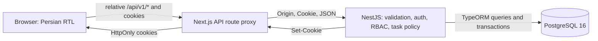

# Architecture

Next.js renders the App Router interface. Its catch-all API route validates path segments, forwards selected headers and preserves each Set-Cookie separately. Browser fetches use relative API paths in frontend/lib/api.ts; BACKEND_URL is server-only. Proxy and API responses disable caching. Business rules remain in NestJS.

## Tokens and cookies

Login normalizes email, checks bcrypt (cost 12), issues an HS256 JWT with subject/session ID/issuer/audience/expiry and an opaque refresh token consisting of a UUID and 32 random bytes. Only the refresh SHA-256 digest is persisted. Tokens are cookies, never JSON response fields. Access defaults to five minutes; refresh defaults to seven days.

Both cookies are HttpOnly, host-only and SameSite lax/strict. Access path is /api/v1, refresh path /api/v1/auth. Production startup requires Secure cookies and HTTPS APP_ORIGIN. The frontend shares one refresh request across concurrent 401 responses, retries calls and never writes tokens to localStorage/sessionStorage.

Refresh locks the session, checks digest/expiry/revocation and active user, revokes the old session and issues a new one preserving the original absolute expiry. Old refresh tokens fail; replay does not revoke the surviving descendant family. Logout revokes the session and clears matching cookie paths; invalid logout can return 401 while still clearing cookies. Access authentication also checks session/user state in PostgreSQL, so logout, rotation and disablement invalidate associated old access tokens immediately.

## CSRF and authorization

Unsafe methods require Origin exactly equal to APP_ORIGIN and reject cross-site Fetch Metadata, including login/refresh/logout. Next preserves Origin rather than constructing it from Host. Authentication guards protect user/task APIs, role guards enforce coarse RBAC and services recheck authorization inside transactions. UI visibility is not a security boundary.

OWNER alone manages users. A PostgreSQL transaction-scoped advisory mutex serializes management mutations and owner-count checks: disabling/demoting the last active OWNER returns 409. Disablement revokes all unrevoked refresh sessions; reactivation does not restore them. Task transactions take a shared authorization lock and recheck active users; updates/deletes lock task rows and authorize persisted ownership before changing fields.

OWNER/MANAGER manage all tasks and may assign active users. MEMBER sees/updates tasks created by or assigned to self, deletes only self-created tasks and cannot newly assign another user. Creator is immutable. Visibility is applied in SQL before count/pagination. Assignee listing exposes only active ID/email to OWNER/MANAGER.

## TipTap and persistence

Raw JSON is checked before class-transformer traverses it and through DTO validation. Allowed nodes: doc, paragraph, text, heading, blockquote, bulletList, orderedList, listItem. Marks: bold, italic, restricted HTTP(S) links. Unknown keys/attributes including JSON-origin __proto__, unsafe links, invalid PostgreSQL text and unsupported embeds are rejected. Limits: 64 KiB, depth 20, 2000 nodes. Frontend mirrors validation and renders saved content as React nodes without HTML injection. TipTap was upgraded to patched 3.31.4; new StarterKit link/underline/trailingNode defaults and the new link title attribute are disabled to preserve the existing schema.

PostgreSQL stores users, refresh_sessions and tasks, with JSONB descriptions, timestamptz dates, enums, foreign keys, unique normalized email and check constraints. API views omit password/token hashes. TypeORM synchronize is false in both data sources. Migrations are explicit and transactional; server startup does not run them. Initial migration installs uuid-ossp if needed and requires privileges. Migration/seed CLIs allow local development taskboard:5433 or an explicitly marked disposable test database. Destructive tests require TEST_DATABASE=true, taskboard_test_* and a non-development port. Destructive down migrations require separate review.

Compose runs only PostgreSQL, mapping loopback 127.0.0.1:5433 to internal 5432 with persistent volume. Backend binds loopback; deployment networking/TLS and production migration workflow need additional work. See known-limitations.md.
